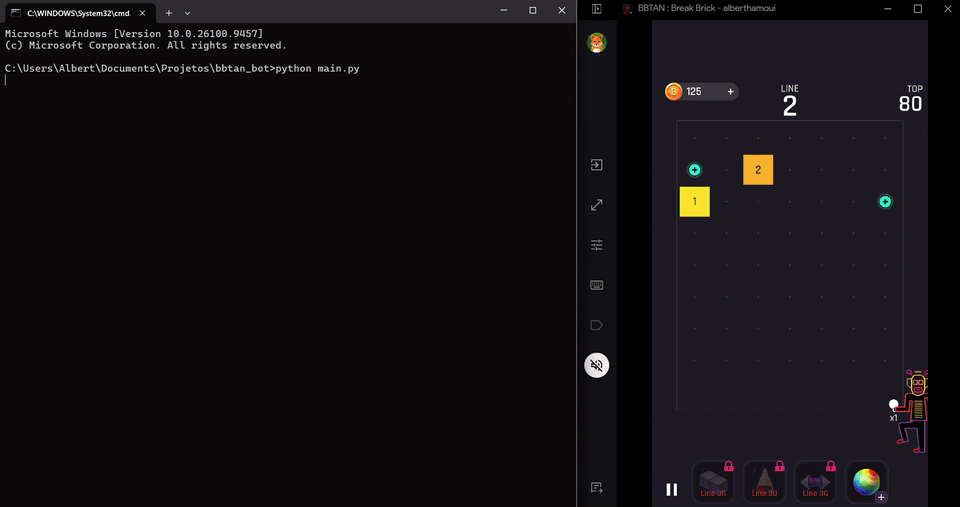
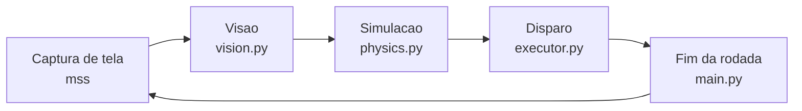
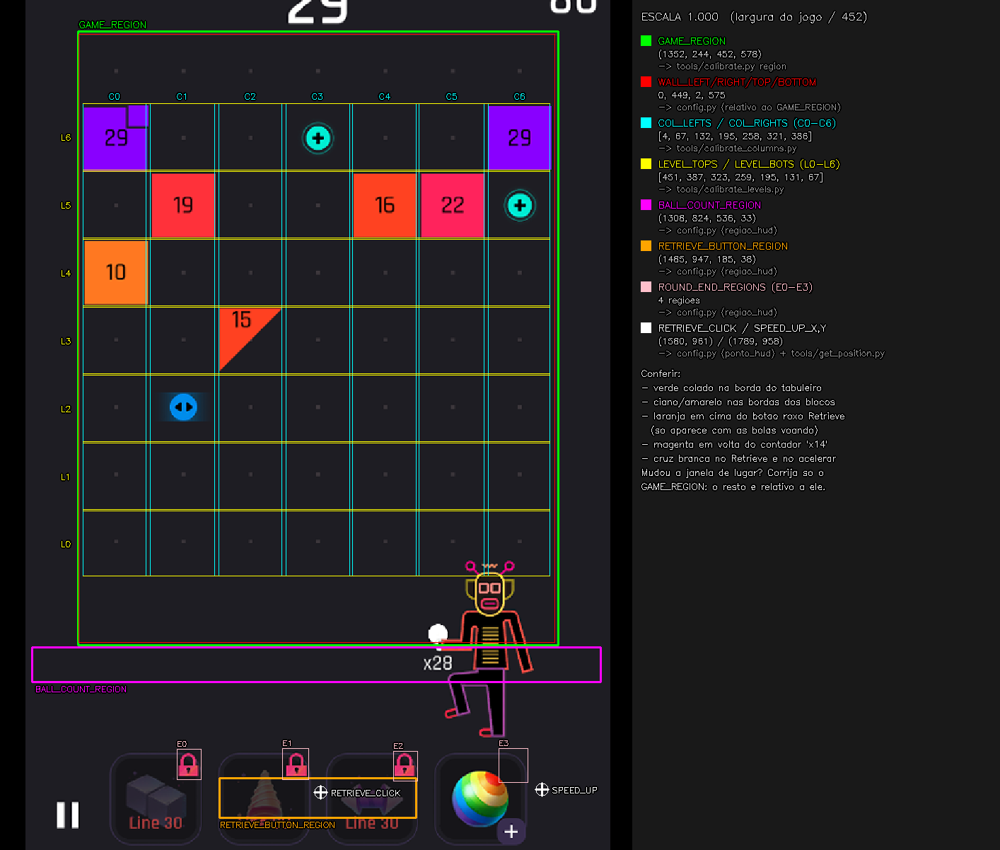

# BBTAN Bot

Bot que joga BBTAN sozinho num emulador Android no PC.




## Como funciona



- **Visao:** isola os blocos por cor (HSV) e contornos, le o HP e o numero de bolas
  por template matching e localiza a bola e os power-ups. Leituras incoerentes com o
  turno anterior (numero de bolas que cai, HP que sobe, HP ilegivel) sao corrigidas.
- **Simulacao:** testa cada angulo de disparo com reflexao em paredes, quadrados e
  triangulos. O score de cada angulo soma hits, blocos destruidos e power-ups, com
  peso maior para as fileiras mais baixas, que sao as mais perigosas.
- **Disparo:** converte o melhor angulo num swipe no emulador (PyAutoGUI).
- **Fim da rodada:** espera o botao retrieve sumir da tela (se demorar demais, clica nele)
  e os blocos pararem de descer.

As regioes da tela, cores e pesos do score ficam em `config.py`.

## Setup

```bash
pip install -r requirements.txt
```

## Calibracao

O bot le a tela por posicao, entao o `config.py` precisa saber onde o jogo esta.
Tudo e relativo ao `GAME_REGION` (o retangulo do tabuleiro): se a janela do
emulador mudar de lugar, normalmente basta corrigir ele.

1. Descubra o `GAME_REGION`:

   ```bash
   python tools/calibrate.py region
   ```

   Arraste um retangulo sobre o tabuleiro e copie o valor impresso para `config.py`.
   Se o jogo continuar do mesmo tamanho, copie so o `x, y` e mantenha a largura e a altura.

2. Confira o resultado:

   ```bash
   python imagem.py
   ```

   Ele tira um print com tudo que o `config.py` marca desenhado por cima do jogo
   e salva em `prints/`:

   

   Esta certo quando:
   - o verde (`GAME_REGION`) esta colado na borda do tabuleiro;
   - a grade ciano/amarela esta nas bordas dos blocos;
   - o magenta envolve o contador de bolas (`x28`);
   - o laranja cobre o botao roxo Retrieve, que so aparece com as bolas voando
     (rode `python imagem.py --delay 3` e dispare);
   - as cruzes brancas estao no Retrieve e no botao de acelerar.

   Onde nao bater, a legenda a direita diz qual variavel ajustar e com qual ferramenta.

## Uso

```bash
python main.py              # roda o bot
python main.py --dry-run    # so visao (janelas de debug), sem simular nem clicar
```

Para parar: Ctrl+C, ou mova o mouse para o canto superior esquerdo da tela.

Cada sessao grava em `logs/bot_N/` (bot_1, bot_2, ...) o log do terminal (`sessao.log`) e,
por turno, a previsao (`turno_NNN_previsto.png`), o rastro real das bolas sobre ela
(`turno_NNN_real.png`) e o contador de bolas lido (`turno_NNN_contador.png`). O log mede
o angulo real de cada tiro e, no turno seguinte, confere o tabuleiro previsto com o lido,
apontando se cada diferenca veio da leitura ou da fisica.
