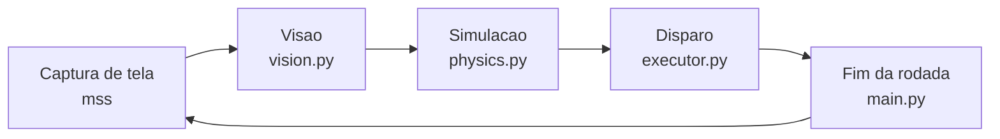

# BBTAN Bot

Bot que joga BBTAN sozinho num emulador Android no PC.

## Como funciona



- **Visao:** isola os blocos por cor (HSV) e contornos, le o HP e o numero de bolas
  por template matching e localiza a bola e os power-ups.
- **Simulacao:** testa cada angulo de disparo com reflexao em paredes, quadrados e
  triangulos. O score de cada angulo soma hits, blocos destruidos e power-ups, com
  peso maior para as fileiras mais baixas, que sao as mais perigosas.
- **Disparo:** converte o melhor angulo num swipe no emulador (PyAutoGUI).
- **Fim da rodada:** espera o botao retrieve sumir da tela; se demorar demais, clica nele.

As regioes da tela, cores e pesos do score ficam em `config.py`.

## Setup

```bash
pip install -r requirements.txt
```

Antes de rodar, ajuste `GAME_REGION` e as coordenadas em `config.py` para a sua tela:

```bash
python tools/calibrate.py region
```

## Uso

```bash
python main.py              # roda o bot
python main.py --dry-run    # so visao + simulacao, sem clicar
```

Para parar: Ctrl+C, ou mova o mouse para o canto superior esquerdo da tela.
