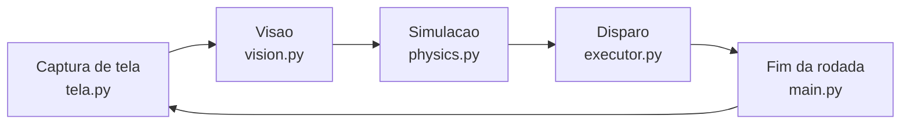

# BBTAN Bot

Bot que joga BBTAN sozinho num emulador Android no PC.


## Como funciona



- **Visao:** isola os blocos por cor (HSV) e contornos, le o HP e o numero de bolas
  por template matching e localiza a bola e os power-ups. Leituras incoerentes com o
  turno anterior (numero de bolas que cai, HP que sobe, HP ilegivel) sao corrigidas.
- **Simulacao:** testa cada angulo de disparo com reflexao em paredes, quadrados e
  triangulos. O score de cada angulo soma hits, blocos destruidos e power-ups, com
  peso maior para as fileiras mais baixas, que sao as mais perigosas.
- **Disparo:** converte o melhor angulo num swipe no emulador (PyAutoGUI), compensando o
  desvio medido da mira do emulador.
- **Fim da rodada:** espera o botao retrieve sumir da tela (se demorar demais, clica nele)
  e os blocos pararem de descer.

As regioes da tela, cores e pesos do score ficam em `config.py`. Toda captura de tela e
todo movimento do mouse passam pelo `tela.py`: no jogo real ele usa mss e PyAutoGUI; no
[jogo local](#jogo-local-sem-emulador) ele fala com uma versao do BBTAN desenhada na memoria.

## Setup

```bash
pip install -r requirements.txt
```

## Calibracao

O bot le a tela por posicao, entao o `config.py` precisa saber onde o jogo esta.
Tudo e relativo ao `GAME_REGION` (o retangulo do tabuleiro): se a janela do
emulador mudar de lugar, normalmente basta corrigir ele.

1. Descubra o `GAME_REGION`:

   ```bash
   python tools/calibrate.py region
   ```

   Arraste um retangulo sobre o tabuleiro e copie o valor impresso para `config.py`.
   Se o jogo continuar do mesmo tamanho, copie so o `x, y` e mantenha a largura e a altura.

2. Confira o resultado:

   ```bash
   python imagem.py
   ```

   Ele tira um print com tudo que o `config.py` marca desenhado por cima do jogo
   e salva em `prints/`:

   

   Esta certo quando:
   - o verde (`GAME_REGION`) esta colado na borda do tabuleiro;
   - a grade ciano/amarela esta nas bordas dos blocos;
   - o magenta envolve o contador de bolas (`x28`);
   - o laranja cobre o botao roxo Retrieve, que so aparece com as bolas voando
     (rode `python imagem.py --delay 3` e dispare);
   - as cruzes brancas estao no Retrieve e no botao de acelerar.

   Onde nao bater, a legenda a direita diz qual variavel ajustar e com qual ferramenta.

## Uso

```bash
python main.py                  # joga no emulador ate voce parar
python main.py --max-turns 10   # para depois de 10 turnos
python main.py --dry-run        # so visao (janelas de debug), sem simular nem clicar
```

Para parar: Ctrl+C, ou mova o mouse para o canto superior esquerdo da tela.

| Opcao | O que faz |
|---|---|
| `--max-turns N` | para depois de N turnos |
| `--partidas N` | para depois de N game overs (sem ela, recomeca sozinho pra sempre) |
| `--sem-janelas` | nao abre as janelas de debug |
| `--delay S` | espera S segundos antes de comecar (padrao 1) |
| `--dry-run` | so le a tela e mostra o que viu, sem atirar |
| `--referencia` | joga e salva capturas limpas do jogo real ([ver abaixo](#capturas-do-jogo-real)) |
| `--local`, `--local-janela`, `--rapido`, `--seed N` | joga o [jogo local](#jogo-local-sem-emulador) |

As janelas de debug (grade de blocos, HP lido, trajetoria escolhida, leque de angulos...)
se ligam e desligam no dicionario `JANELAS`, no topo de `tools/visualizar_masks.py`.

### O que fica salvo

Cada partida grava em `logs/bot_N/` (uma pasta nova a cada game over):

- `sessao.log`: o log do terminal. Por turno: o tabuleiro lido, o angulo escolhido, o
  angulo real de saida medido e, no turno seguinte, a conferencia do tabuleiro previsto
  com o lido, dizendo se cada diferenca veio da leitura ou da fisica;
- `turno_NNN_previsto.png`: a trajetoria prevista;
- `turno_NNN_real.png`: o rastro real das bolas sobre a previsao;
- `turno_NNN_contador.png`: o contador de bolas lido.

Cada game over vira uma linha em `historico.txt`.

## Jogo local (sem emulador)

`jogo_local/` e uma versao do BBTAN que roda na memoria, com aparencia, fisica e regras
medidas no jogo real. O bot joga ela com o mesmo codigo de visao, simulacao e mouse; so o
`tela.py` troca o emulador pelo jogo local. Serve pra testar mudancas no bot sem abrir o
emulador e pra comparar versoes do bot com numeros.

```bash
python main.py --local-janela --seed 7                   # assistir: janela no lugar do emulador
python main.py --local --sem-janelas --max-turns 10      # sem nenhuma janela, tempo real
python main.py --rapido --sem-janelas --seed 7 --partidas 1   # uma partida inteira, rapido
```

| Opcao | O que faz |
|---|---|
| `--local` | joga o jogo local em vez do emulador |
| `--local-janela` | igual, mostrando o jogo numa janela exatamente onde fica o emulador |
| `--rapido` | relogio virtual: as esperas do bot nao esperam de verdade (ja inclui `--local`) |
| `--seed N` | fixa o sorteio das fileiras: a mesma seed sempre gera o mesmo jogo |

- No jogo local a mira nao tem desvio, entao a compensacao do emulador fica desligada.
- Com `--rapido`, o que sobra de tempo e a simulacao de angulos do proprio bot (uma
  partida de 60 rodadas leva uns 8 min). Mesma seed + mesmo bot = mesma partida.
- Logs em `logs/local_N/` (ou `logs/local_sN_M/` com `--seed N`). No fim aparece
  `RESULTADO LOCAL: seed 7 | partida 1 | rodada 63 | ...`, e cada game over vai pra
  `historico_local.txt` (separado do jogo real).

### Comparar duas versoes do bot

Rode as mesmas seeds antes e depois da mudanca, varias em paralelo (uma por nucleo):

```bash
python tools/partidas_locais.py --seeds 1-8 --nome antes
# ... muda o bot ...
python tools/partidas_locais.py --seeds 1-8 --nome depois
```

Cada um mostra a rodada final de cada seed e a media, e salva em
`logs/partidas_locais/<nome>.csv`.

### O que o jogo local nao reproduz

- Os erros de leitura da tela real (OCR): uma melhoria de OCR tem que ser conferida no
  emulador.
- Rodadas longas: depois de muitas batidas pequenas diferencas se acumulam, entao o fim
  de uma rodada longa nao sai identico ao do jogo real (o resultado medio, sim).
- Algumas regras foram estimadas com poucos dados: o raio em que a bola pega um
  power-up, a direcao sorteada pelo R e onde nascem os blocos do divisor.

## Capturas do jogo real

O jogo local foi montado e e validado a partir de capturas do jogo real:

```bash
python main.py --referencia                   # joga e grava a cada turno
python main.py --referencia --rajada-cada 2   # grava a rodada inteira a cada 2 turnos (padrao 5)
python tools/capturar_jogo.py                 # manual: F8 tela, F9 rajada de 4 s, F10 sai
```

Com `--referencia`, cada partida vai pra `logs/captura_analise_N/` e a subpasta
`referencia/` guarda a janela inteira antes de cada tiro (`tela_tNNN.png`) e rajadas de
60 fps das rodadas (`rajada_tNNN/`).

Pra conferir o jogo local contra elas (real x local x physics.py do bot):

```bash
python tools/validar_desenho_local.py   # a tela desenhada e lida igual a real?
python tools/validar_fisica_local.py    # as bolas andam igual ate o acelerar?
python tools/validar_rodadas_local.py   # a rodada termina com o mesmo tabuleiro?
```

Com capturas novas, da pra atualizar o que o jogo local sorteia e mede:

```bash
python tools/analisar_capturas.py logs/captura_analise_1 logs/captura_analise_2   # rodada, blocos e power-ups
python tools/estatisticas_fileiras.py      # frequencias da fileira nova -> jogo_local/assets/fileiras.json
python tools/medir_rajadas.py --rebotes    # velocidade, paredes e contato com os blocos
```

## Estrutura

| Arquivo | Papel |
|---|---|
| `main.py` | loop principal e opcoes da linha de comando |
| `config.py` | regioes da tela, cores, pesos do score |
| `tela.py` | captura de tela e mouse (jogo real ou local) |
| `vision.py` | leitura do tabuleiro |
| `physics.py` | simulacao dos angulos |
| `executor.py` | disparo (swipe), acelerar e retrieve |
| `log_turno.py` | log e imagens de cada turno |
| `jogo_local/` | o jogo local: `desenho.py` (tela), `fisica.py` e `jogo.py` (regras), `gerador.py` (fileiras novas), `tempo_real.py` e `relogio.py` (relogio), `backend.py` (ligacao com o `tela.py`) |
| `tools/` | calibracao, capturas, validacao do jogo local e janelas de debug |
